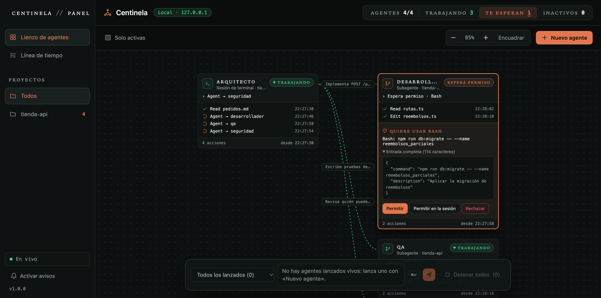

# Centinela

[](https://github.com/AndrishAraiza0412/centinela/actions/workflows/ci.yml)

**Agent observability with human approval of permissions.** A local dashboard to watch your Claude Code sessions and subagents live, launch agents by role, send them prompts and approve or reject what they want to do.



*Demo data. The interface is in Spanish.*

- **See what agents do:** every session and subagent is a live card with its status, recent actions and delegations.
- **Decide what they may do:** launched agents ask before acting. Each request shows the full input, with invisible characters flagged, and is denied if nobody answers.
- **Fail closed:** no answer in 5 minutes, or Centinela switched off, means the request is rejected.
- **Local and dependency-free:** Node ≥ 22, no packages, no CDN, works offline. Listens only on `127.0.0.1:4317`. 108 automated tests.

## Getting started

```sh
node bin/centinela.js
```

It prints `http://127.0.0.1:4317/#pair=…` and opens it in your browser. That code works **once**: the page exchanges it for a session token that lives only in that tab (it survives reloads). To open another tab, or after restarting Centinela, run `node bin/centinela.js` again from your terminal.

Start it from your own terminal, not from a Claude Code session: the output of a command launched by Claude ends up in files other commands can read.

## Observing your sessions (hooks)

```sh
node bin/centinela-hooks.js install     # shows the diff and asks for confirmation
node bin/centinela-hooks.js uninstall   # removes only what Centinela added
```

- Writes to `$CLAUDE_CONFIG_DIR/settings.json` (or `~/.claude/settings.json`) and leaves a `settings.json.centinela-backup-<ts>` copy before each change.
- Adds one `http` hook per event pointing to `/hooks/event`. Your own hooks are left alone; Centinela's are recognized by their URL.
- If your sandbox is on, it adds `127.0.0.1:4317` (only Centinela's port) to `sandbox.network.allowedDomains`; without that, hooks get a 403. Sandboxed commands can reach that port, but without the page token they can only send validated events. `uninstall` removes the entry only if Centinela added it.
- With Centinela off, observation hooks fail silently: your sessions carry on as usual.

## The dashboard

- **Starts empty:** the canvas only shows what happens after you open Centinela (history stays in `~/.centinela/`).
- **Projects:** the sidebar has one view per folder with agents and its count of active agents; "Todos" (All) shows them together.
- **Agent canvas:** each session and subagent is a card (status, current activity, recent actions, last response and, if it is waiting on you, its permission request right there). Dotted lines show the delegated task. Drag the background or swipe with two fingers to move; pinch or ⌘+wheel to zoom; "Encuadrar" (Fit) shows everything again.
- **Waiting on you:** the counter at the top takes you to the agent waiting for a permission. A waiting agent is always visible, even if filters would hide it.
- **Command bar:** message all launched agents or one of them (⌘↩), "Nuevo agente" (New agent) and "Detener todos" (Stop all, asks for confirmation).
- **Timeline:** one lane per agent.

## Agents launched from the dashboard

"Nuevo agente" runs `claude -p --agent <role>` in the folder you choose, with the model you choose: your configured one, the latest of each family or a specific version (the list is in `src/shared/models.js`).

**Team** (dialog checkbox, on by default): the agent gets the other roles as subagents and instructions to split independent parts in parallel, have a different role review each result, send failures back for correction (up to 3 rounds) and keep coordinating when you ask for more. Subagents cannot delegate further: the coordinator assigns the work. Their permissions go through the dashboard just like the agent's; to see each subagent as a card, install the observation hooks.

- **Launching a subagent asks for permission** (in every launched agent, with or without a team): the card says which role, what for and the full assignment.
- **Two agents, one file:** if an agent wants to change a file that another still-active agent already changed (or is asking to change), Centinela does not ask you yet. It returns the other agent's change so the agent can reread the file and integrate both, or explain the conflict to the coordinator. The second attempt reaches you as a normal card, marked "Otro agente también cambia este archivo" (Another agent is also changing this file), with the other change to compare. The agent's card records a "Revisión" (Review) action.

Roles come from:

- Centinela's `roles/*.md` (built in): developer, architect, legal, designer, QA, security, DevOps, documentation, product and data. They are passed with `--agents` at launch and do not touch your configuration. If you or the project have a role with the same name, that one is used.
- Your Claude Code agents folder (`agents/*.md`) and the project's `.claude/agents/*.md`.

How they run:

- They use the `default` permission mode (if `claude` reports another mode at startup, Centinela stops it). Each permission appears as a card with the full input, and invisible characters or space padding are flagged. Allow / Allow this same action for the session (same tool, same agent and exactly the same input) / Reject.
- All Bash goes through the dashboard, including commands that would run inside the sandbox (in your terminal sessions Claude Code auto-approves those; in launched agents this is turned off with `autoAllowBashIfSandboxed: false`).
- `claude -p` skips the folder trust dialog: if the folder has `.claude/settings*.json` or `.mcp.json`, the dashboard asks you to confirm before launching.
- A project role with the same name as one of yours cannot be launched there (you would not know which one runs).
- No answer in 5 minutes → rejected. Centinela off → rejected (`onFailure: block`).
- "Continuar aquí" (Continue here), on a terminal session, resumes it with `--resume` on a new branch; the terminal's session does not change.

## Data and tokens

Everything lives in `~/.centinela/` (`0700`; files `0600`):

| File | Purpose |
|---|---|
| `hook-token` | Only allows sending events to `/hooks/event` (they are validated). Written in your `settings.json`. |
| `events-YYYY-MM-DD.jsonl` | Event history. May contain whatever your agents read or wrote. Not reloaded at startup. |

The page token is never stored on disk: it is generated on each start and delivered only through the single-use code. Each launched agent also gets its own in-memory token, which can only request permissions and dies with the agent.

## Development

```sh
npm test
```

Test variables: `CENTINELA_HOME`, `CENTINELA_PORT`, `CENTINELA_CLAUDE_BIN`, `CENTINELA_NO_OPEN`, `CENTINELA_PERMISSION_TIMEOUT_MS`.

Documentation (in Spanish): `docs/diseno-v1.md` (design and threat model), `docs/plan-v1.md`, `docs/spike-notes.md`, `docs/decisiones-v1.md`, `docs/pendientes-v1.md`; visual system in `DESIGN.md` and product in `PRODUCT.md`.
